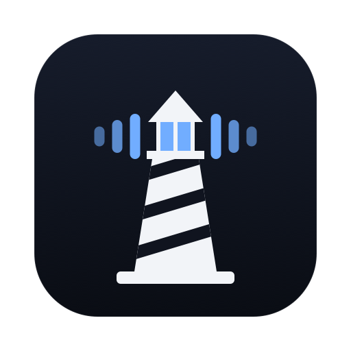

<p align="center">
  
</p>

<h1 align="center">Farol Voice</h1>

<p align="center">Talk to your Mac. Your words stay on it.</p>

<p align="center">
  
  <a href="LICENSE"></a>
</p>

Hold a key, talk, let go, and your words appear wherever you were typing: your editor, your terminal, Slack, a browser. Speech runs on your Mac, with no account, no subscription and nothing sent anywhere.

It's the first step toward a voice assistant for your terminal and coding agents, working with [Farol](https://github.com/snowztech/farol). Today it's dictation, and that part is ready to use every day. See [what's next](ROADMAP.md).

## What it does

- **Works everywhere.** It types into any app, and puts your clipboard back afterwards.
- **Runs on your Mac.** Audio is never sent anywhere or saved. Once a model is installed, it needs no network.
- **Fast.** About a tenth of a second to transcribe a short phrase on Apple Silicon, using the Parakeet V3 model.
- **Your choice of model.** Parakeet V3 for speed in English and 24 more languages, or Whisper for about 100 languages. Install, switch and delete them yourself.
- **Gets your words right.** Add names and terms, and close matches become exactly what you wrote.
- **Careful with your words.** It won't type into a password field, and if you switch apps while it's working, the text goes to your clipboard and not the wrong window.
- **Quiet.** A small waveform shows while the mic is open, and it uses no CPU between uses.

## Install

There's no download yet, so build it from source. You need macOS 15 or later on Apple Silicon, and Xcode 26.

```sh
git clone https://github.com/snowztech/farol-voice && cd farol-voice
make run
```

The setup window walks you through the rest: allow the microphone and Accessibility, install a model, and try it. After that it lives in your menu bar, under the sound bars.

Hold **Fn** to talk, or choose Right Option in Settings. If Fn opens the emoji picker, change what it does in System Settings, Keyboard.

Models are in `~/Library/Application Support/Farol Voice/models`.

## Why Accessibility?

macOS needs it for two things: noticing the key while you're in another app, and typing your words for you. Farol Voice only looks for the key you chose, and doesn't record or store what you type. The code is here to read: [`Dictation.swift`](Sources/FarolVoice/Dictation.swift) and [`Typer.swift`](Sources/FarolVoice/Typer.swift).

## Contributing

See [CONTRIBUTING.md](CONTRIBUTING.md). To compare models on your own recordings:

```sh
swift run -c release farol-voice transcribe clip.wav --words "Farol, snowztech"
```

## License

[MIT](LICENSE). The speech models have their own licenses, listed in [THIRD_PARTY_NOTICES](THIRD_PARTY_NOTICES).
